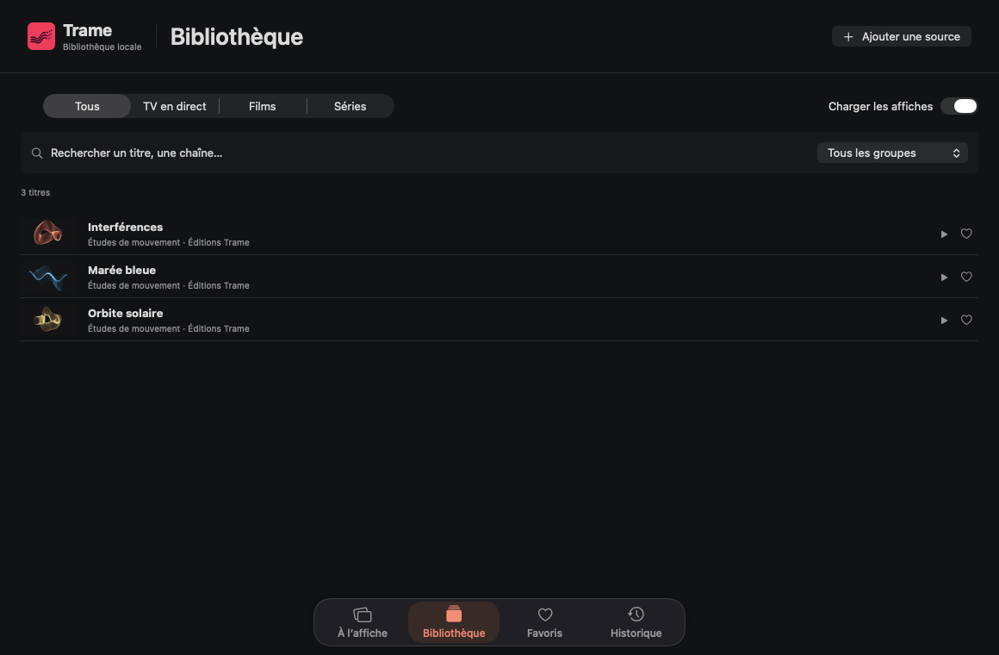
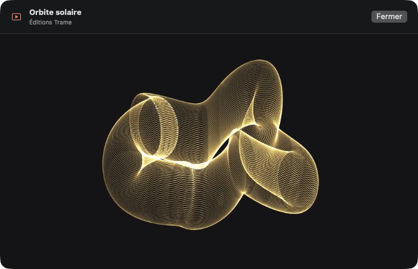
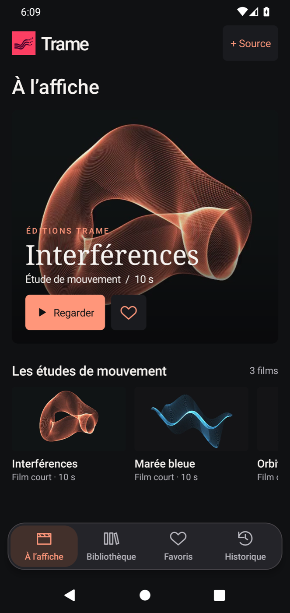
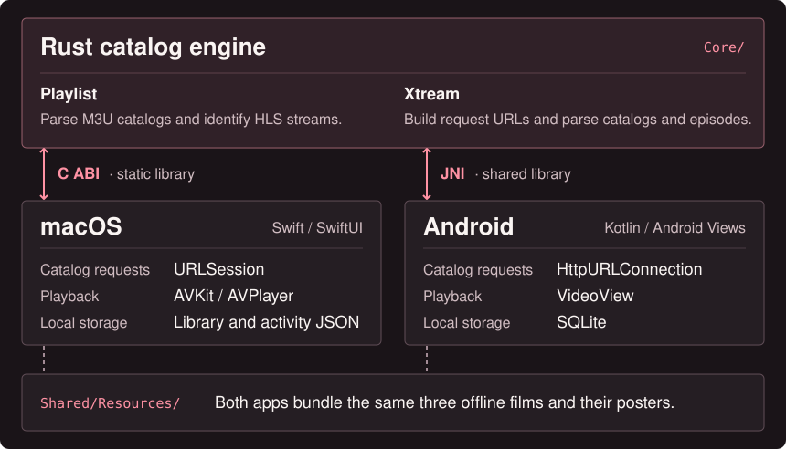

[](Artwork/AppLogo.png)

# Trame

Play a local file, open an M3U playlist or browse an Xtream catalog. Trame pairs a shared Rust catalog engine with two native players, SwiftUI and AVKit on macOS and Kotlin and VideoView on Android. Both apps open with three silent, ten-second films you can watch offline. The interface is in French.

[Download Trame 0.1.0](https://github.com/JeremySomsouk/trame/releases/tag/v0.1.0) · [Build from source](#build-from-source) · [Architecture](#architecture)

## Install

| Platform | Release asset | First launch |
| --- | --- | --- |
| macOS 14+, Intel or Apple silicon | `Trame-v0.1.0-macOS-universal.zip` | Unzip in Finder, move **Trame.app** to **Applications**, then open it. |
| Android 8+ | `Trame-v0.1.0-Android.apk` | Open the APK on your device and, if prompted, allow your file manager to install it. |

The Mac app has an ad-hoc signature and has not been notarized by Apple. If Gatekeeper blocks the downloaded app, first try opening it from Applications. If you trust this copy, use **System Settings → Privacy & Security → Open Anyway**. [Apple’s instructions](https://support.apple.com/en-us/guide/mac-help/mh40616/mac)

## In the player

[](docs/images/macos-library.png)

<a href="docs/images/macos-playback.png"></a>
<a href="docs/images/android-library.png"></a>

- **Open a source.** Choose **+ Source** on Android or press **⌘O** on Mac. Open a video or audio file, paste a media URL, or import a local or remote playlist. HLS manifests open as one playable stream. For an HLS playlist with relative segments on Android, use its web address.
- **Browse a subscription.** Enter the Xtream server address (including its port), username and password. **Tout le catalogue** imports live channels, movies and series in one go. For live channels alone, choose **Direct** on Android or **Toutes les chaînes en direct** on Mac. Both apps accept up to 2 GiB per playlist or Xtream response, including movies, series and episode lists. Open a series to load its episodes.
- **Play older formats.** If the native player fails, Trame opens the same media with its bundled VLC engine. Choose **VLC** in the player to switch manually if playback stalls or only audio comes through. VLC includes its own audio and subtitle track controls.
- **Move or resize the Mac player.** Drag its title bar to move it, drag an edge or corner to resize it, or use the green window button for full screen. Switching to VLC keeps the same window. On Android, resize the player using the system split-screen divider or the window edges in desktop mode.
- If an Xtream account opens its catalog but playback fails, check for spaces at the edges of the username or password. On Android, the player retries once without those spaces after a playback I/O error, including for previously saved accounts.
- **Browse on a phone.** **À l’affiche** features the three offline shorts. In **Bibliothèque**, choose a source, then **Tous**, **Direct**, **Films** or **Séries**. Open **Catégories** to browse or search every level of the selected type. Search results show the full category path. The bottom navigation opens **Favoris** and **Historique**.
- **Filter the Mac library.** Choose **TV en direct**, **Films** or **Séries** above search. Open **Catégories** to browse the provider’s hierarchy or search it by name, including subcategories. Selecting a parent includes its descendants. Flat source groups appear as a single level. Use **⌘1** through **⌘4** to switch between the four main screens.
- **Show posters.** Trame loads provider artwork for visible titles. Turn off **Charger les affiches** in the Mac library or **Affiches** on Android to skip image downloads. Refresh older sources once to retrieve their poster addresses.
- **Choose audio and subtitles.** Open **Audio et sous-titres** (the caption icon) in the player to select one of the tracks exposed by the media and supported by the device. Choose **Désactivés** to turn off optional subtitles.
- **Find a title.** Search by title, group or source. On Mac, **⌘F** focuses search. Mark a favorite or open the history to find a recent title again. In **Historique**, **Effacer tout l’historique** clears all playback history, including entries outside the current search. Favorites are preserved.
- **Refresh or remove.** On Android, tap the refresh arrow beside the selected playlist or Xtream catalog. Refresh a previously imported M3U once to recover any explicit category tags the older Android app discarded. To remove a source, open **+ Source → Gérer les sources**. On Mac, press **⌘R** to refresh. If a refresh fails, the last imported catalog remains available. Removing an imported item from the library preserves the original media file.

Trame ships the three demo films. You supply any other media, playlists and subscriptions. Use sources you have permission to access.

## Architecture

Each app ships as one modular monolith. A change to a playlist rule or an Xtream response format belongs in the Rust crate and reaches both frontends. The native player receives the resulting media address and handles decoding, buffering and playback controls.

[](docs/images/architecture.svg)

| Component | Responsibility |
| --- | --- |
| [Rust engine](Core/src/) | Resolve playlist entries against their origin, recognize HLS, construct Xtream requests and parse live, movie, series and episode catalogs. |
| [C and JNI bindings](Core/src/bindings/) | Expose the same engine as a static library for Swift and a shared library for Kotlin. The [C header](Core/include/trame_core.h) defines the Swift-facing interface. |
| [macOS frontend](macOS/Sources/) | URLSession fetches catalogs, SwiftUI presents the library and AVKit plays media. |
| [Android frontend](Android/src/app/trame/player/) | Kotlin opens documents and HTTP connections, indexes the library in SQLite and plays media with Android’s native VideoView. |
| [Shared resources](Shared/Resources/) | Both builds package the same films, posters and Trame mark. |

## Privacy and network access

The demo library works offline. Adding or refreshing a subscription sends requests to the address you enter. Playlists, redirects and media manifests can also point to other hosts. Opening a title contacts the hosts that serve its media. With posters enabled, browsing can also contact the image hosts specified by a playlist or provider. Use HTTPS where your provider offers it. With HTTP, anyone able to observe the connection can read credentials or tokens sent over it.

- **macOS** stores imported addresses in `~/Library/Application Support/Trame/library.json`. Xtream credentials and playlist tokens can appear in plain text. Keep this file and its backups private. `activity.json` stores favorites and the last 40 plays as hashed address references. Older activity is migrated on launch. When a title disappears from all catalogs, its activity is pruned. To enable refresh on a playlist imported with an older version, add its original URL or file once.
- **Android** stores sources, titles, favorites and history in its app-private SQLite database. Source, playback and activity records can contain credential-bearing addresses. Android backup is disabled for the app.
- **HTTP-only sources** work on Android and in macOS builds from this revision. Enter the full `http://` address with its port. A playlist, redirect or media stream can use another HTTP host. The original macOS 0.1.0 download predates this change. To restrict HTTP to one hostname in a personal Mac build, use `./scripts/build-app.sh --http-host media.example`. This build uses the native player for network media so redirects also follow the hostname restriction.

## Build from source

Run the commands from the repository root. Install stable Rust (1.88 or later) with rustup and install Python 3. If you also have Homebrew Rust installed, run the following before building so Cargo uses the cross-compilation targets installed by rustup.

```sh
export PATH="$HOME/.cargo/bin:$PATH"
```

The build scripts fetch checksum-pinned VideoLAN playback libraries on first use and cache them in `.build/vlc/`. The packaged apps include the engine for offline use.

### macOS

Install Xcode with Swift 6 or the corresponding Command Line Tools. Build an app for the current Mac, or run the development executable with `./scripts/swift-with-core.sh run Trame`.

```sh
./scripts/build-app.sh
open dist/Trame.app
```

Run the Rust and Swift test suites against the shared engine.

```sh
cargo test --locked --manifest-path Core/Cargo.toml
./scripts/swift-with-core.sh test
```

If the standalone Command Line Tools cannot locate the Swift Testing macros, supply the plugin path explicitly.

```sh
./scripts/swift-with-core.sh test --disable-xctest -Xswiftc -plugin-path -Xswiftc "$(xcode-select -p)/usr/lib/swift/host/plugins/testing"
```

### Android

Install JDK 17 or later, Kotlin/JVM 2.2 and the Android command-line tools. Set `ANDROID_HOME` to the SDK location. The build finds `kotlinc` on your path or in Android Studio on macOS. You can also set `KOTLINC` to its script.

```sh
sdkmanager "platforms;android-36" "build-tools;36.0.0" "ndk;27.1.12297006"
rustup target add aarch64-linux-android armv7-linux-androideabi x86_64-linux-android i686-linux-android
./scripts/build-android.sh
```

The signed APK is written to `dist/Trame.apk` with libraries for arm64-v8a, armeabi-v7a, x86_64 and x86. The first build creates a private signing identity under `.android-signing/`. Keep it private and back it up to sign compatible updates.

### Release builds

A version tag such as `v0.1.0` triggers the GitHub Actions workflow that tests and packages the universal Mac ZIP. To reproduce the build locally from the tagged source, run:

```sh
rustup target add aarch64-apple-darwin x86_64-apple-darwin
./scripts/build-app.sh --release v0.1.0
```

The output is `dist/Trame-v0.1.0-macOS-universal.zip`. CI builds an Android APK with a disposable key for validation. The maintainer builds the downloadable APK with the persistent release key.

## License

Trame’s source is licensed under the [GNU General Public License, version 3](LICENSE). The release packages include the project license and dependency notices.
